

  

  Llevo productos <b>de la idea a producción</b>: diseño la API, levanto el panel web,
  publico la app móvil y dejo el servidor endurecido para que todo eso siga en pie.

  

---

## 🧰 Mi caja de herramientas

<table align="center">
  <tr>
    <td align="center" width="96"> <b>TypeScript</b></td>
    <td align="center" width="96"> <b>JavaScript</b></td>
    <td align="center" width="96"> <b>Rust</b></td>
    <td align="center" width="96"> <b>React</b></td>
    <td align="center" width="96"> <b>React Native</b></td>
    <td align="center" width="96">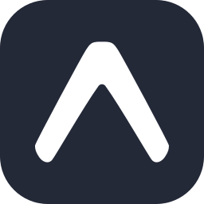 <b>Expo</b></td>
    <td align="center" width="96"> <b>Node.js</b></td>
  </tr>
  <tr>
    <td align="center" width="96"> <b>Express</b></td>
    <td align="center" width="96">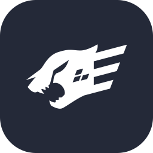 <b>Fastify</b></td>
    <td align="center" width="96"> <b>Axum</b></td>
    <td align="center" width="96"> <b>Vite</b></td>
    <td align="center" width="96"> <b>Material UI</b></td>
    <td align="center" width="96">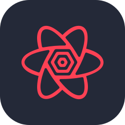 <b>TanStack Query</b></td>
    <td align="center" width="96">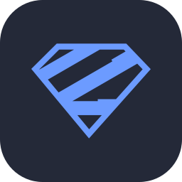 <b>Zod</b></td>
  </tr>
</table>

<h3>🗄️ Datos</h3>

<table align="center">
  <tr>
    <td align="center" width="96"> <b>PostgreSQL</b></td>
    <td align="center" width="96">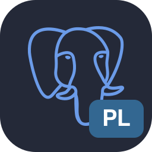 <b>PL/pgSQL</b></td>
    <td align="center" width="96"> <b>SQL Server</b></td>
    <td align="center" width="96">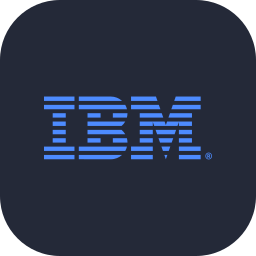 <b>IBM i / Db2</b></td>
    <td align="center" width="96"> <b>Redis</b></td>
    <td align="center" width="96"> <b>SQLite</b></td>
  </tr>
</table>

<h3>🚢 Infraestructura y DevOps</h3>

<table align="center">
  <tr>
    <td align="center" width="96"> <b>Docker</b></td>
    <td align="center" width="96"> <b>Nginx</b></td>
    <td align="center" width="96"> <b>Linux</b></td>
    <td align="center" width="96"> <b>Cloudflare</b></td>
    <td align="center" width="96"> <b>Tailscale</b></td>
  </tr>
  <tr>
    <td align="center" width="96"> <b>pnpm</b></td>
    <td align="center" width="96">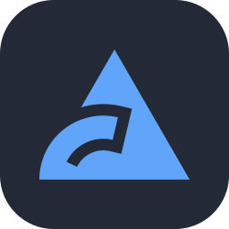 <b>Biome</b></td>
    <td align="center" width="96">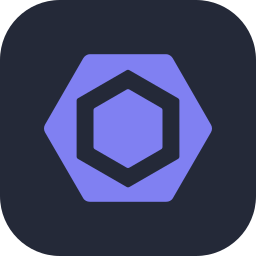 <b>ESLint</b></td>
    <td align="center" width="96"> <b>Prettier</b></td>
    <td align="center" width="96"> <b>Git</b></td>
  </tr>
</table>

<h3>🔌 Integraciones</h3>

<table align="center">
  <tr>
    <td align="center" width="96">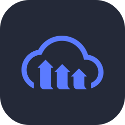 <b>Cloudinary</b></td>
    <td align="center" width="96"> <b>Resend</b></td>
    <td align="center" width="96"> <b>Google APIs</b></td>
    <td align="center" width="96"> <b>Apple</b></td>
    <td align="center" width="96">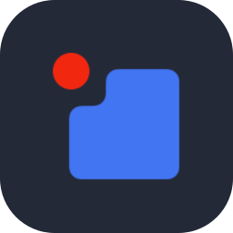 <b>PixelPay</b></td>
    <td align="center" width="96">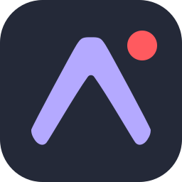 <b>Expo Push</b></td>
    <td align="center" width="96">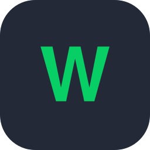 <b>Wrike</b></td>
  </tr>
</table>

<h3>🤖 IA y automatización</h3>

<table align="center">
  <tr>
    <td align="center" width="96"> <b>Claude Code</b></td>
    <td align="center" width="96"> <b>OpenCode</b></td>
    <td align="center" width="96">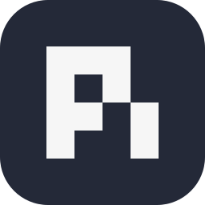 <b>Pi</b></td>
    <td align="center" width="96">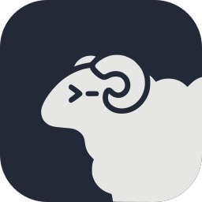 <b>Herdr</b></td>
  </tr>
</table>

---

## 🚀 Lo que he construido

<table>
  <tr>
    <td width="50%" valign="top">
      <h3>&nbsp; ELGA Móvil+</h3>
      Banca cooperativa en el bolsillo: cuentas, préstamos, transferencias, pagos de servicios
      y comprobantes, con biometría, SSL pinning y detección de jailbreak.
        
      
      
    </td>
    <td width="50%" valign="top">
      <h3>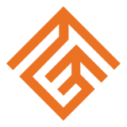&nbsp; ELGA en Línea</h3>
      La misma banca desde el navegador, con enlaces cifrados para cuentas, préstamos
      y servicios.
        
      
      
      
      
    </td>
  </tr>
  <tr>
    <td width="50%" valign="top">
      <h3>&nbsp; ELGA CRM</h3>
      Panel interno para atender a cada asociado con toda su información a mano
      y dar seguimiento a sus gestiones desde un solo lugar.
        
      
      
      
      
      
    </td>
    <td width="50%" valign="top">
      <h3>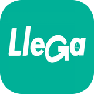&nbsp; Llega</h3>
      Delivery multi-local: pedidos, repartidores, locales y pagos con tarjeta (3DS) y QR.
        
      
      
      
      
      
    </td>
  </tr>
  <tr>
    <td colspan="2" valign="top">
      <h3>🔪 <a href="https://github.com/camiloeferrera/port-killer">port-killer</a></h3>
      Extensión de GNOME Shell que lista los puertos TCP de tus procesos y los mata
      con un clic. Open source, GPL-2.0.
        
      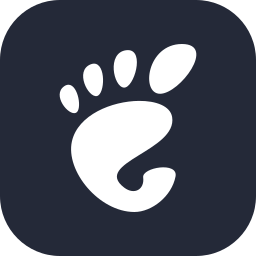
      
    </td>
  </tr>
</table>

🔒 La mayoría de estos repositorios son privados por ser trabajo para clientes.

---

## 🧭 Cómo trabajo

- 🛡️ **Seguro por defecto.** JWT + bcrypt, rate limiting, SSL pinning, secretos fuera del código, SSH solo por VPN y Cloudflare al frente.
- 🧱 **Tipos y validación en los bordes.** TypeScript estricto, Zod en las APIs, SQLx en Rust.
- 📦 **Contenedores mínimos.** Builds multi-stage, Nginx para SPAs y distroless para Rust.
- 🤖 **Agentes como compañeros de equipo.** Skills reutilizables, MCP y orquestación de agentes por repositorio.

---

  <b>¿Construimos algo?</b> Abre un issue o escríbeme por GitHub. 👋

